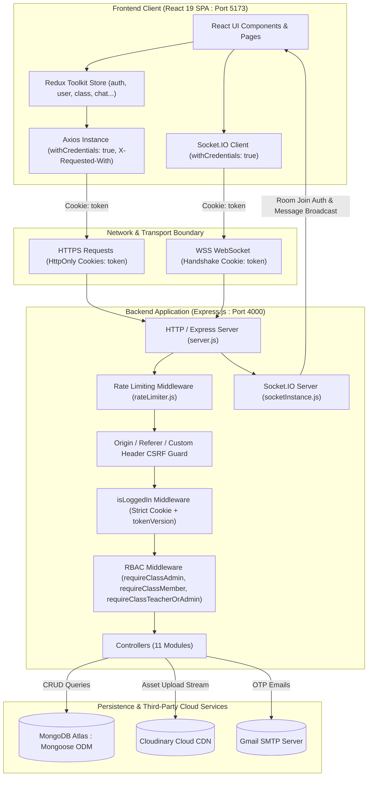
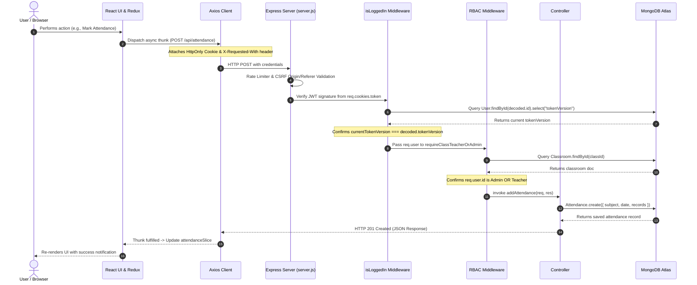
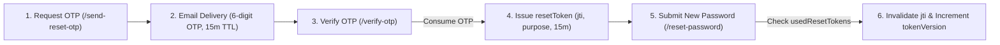
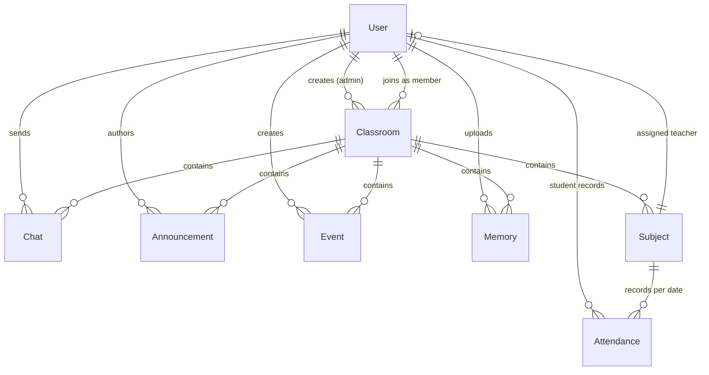
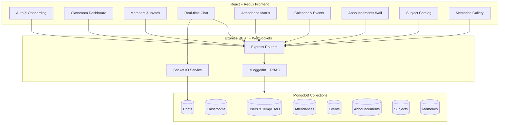

# Class Connect — Full-Stack Educational Platform & Technical Interview Master Handbook

> **Project Name:** Class Connect  
> **Repository Root:** `/home/syed-rumanuddin/Projects/ClassConnect-main`  
> **Tech Stack:** React 19, Redux Toolkit, React Router v7, Tailwind CSS v4, Node.js (ESM), Express.js 4.21, MongoDB / Mongoose 8, Socket.IO 4.8, Cloudinary v2, Nodemailer  
> **Author & Maintainer:** Syed Rumanuddin  
> **Audience:** Senior Software Engineers, Technical Architects, Hiring Managers, Technical Interview Panels  

---

## Table of Contents
1. [Project Overview & Architecture Discovery](#1-project-overview--architecture-discovery)
2. [Complete System Architecture](#2-complete-system-architecture)
   - [Architectural Topology & Data Flow](#21-architectural-topology--data-flow)
   - [Folder Structure Deep Dive](#22-folder-structure-deep-dive)
   - [Frontend-to-Backend-to-Database Lifecycle](#23-frontend-to-backend-to-database-lifecycle)
3. [Master API Documentation (All 29 Endpoints)](#3-master-api-documentation-all-29-endpoints)
   - [API Summary Matrix & Method Breakdown](#31-api-summary-matrix--method-breakdown)
   - [Detailed Specification per Endpoint](#32-detailed-specification-per-endpoint)
4. [Middleware Deep Dive](#4-middleware-deep-dive)
5. [Authentication & Authorization Deep Dive](#5-authentication--authorization-deep-dive)
   - [The Strict HttpOnly Cookie Architecture](#51-the-strict-httponly-cookie-architecture)
   - [Active Session Revocation via Token Versioning](#52-active-session-revocation-via-token-versioning)
   - [Two-Factor Password Reset & Replay Prevention](#53-two-factor-password-reset--replay-prevention)
   - [Authentication vs. Authorization & Concept Comparisons](#54-authentication-vs-authorization--concept-comparisons)
6. [Database Architecture & Schema Deep Dive](#6-database-architecture--schema-deep-dive)
   - [Master Schema Table](#61-master-schema-table)
   - [Entity-Relationship Diagram](#62-entity-relationship-diagram)
   - [Field-Level Specifications & Indexes](#63-field-level-specifications--indexes)
7. [Feature-Wise Implementation Walkthrough](#7-feature-wise-implementation-walkthrough)
8. [HTTP Status Codes & Centralized Error Handling](#8-http-status-codes--centralized-error-handling)
9. [Core Technical Concepts & Code Illustrations](#9-core-technical-concepts--code-illustrations)
10. [Critical Code Implementations & Line-by-Line Analysis](#10-critical-code-implementations--line-by-line-analysis)
11. [Technical Interview Question Bank (100+ Questions)](#11-technical-interview-question-bank-100-questions)
    - [Level 1: Fundamentals (25 Questions)](#level-1-fundamentals-25-questions)
    - [Level 2: Intermediate API, Middleware & DB (30 Questions)](#level-2-intermediate-api-middleware--db-30-questions)
    - [Level 3: Project-Specific Architecture & Security (30 Questions)](#level-3-project-specific-architecture--security-30-questions)
    - [Level 4: Advanced System Design, Concurrency & Scalability (15 Questions)](#level-4-advanced-system-design-concurrency--scalability-15-questions)
12. [Real-World Interview Scenarios & Failure Handling](#12-real-world-interview-scenarios--failure-handling)
13. [60-Second Quick Revision & Cheat Sheet](#13-60-second-quick-revision--cheat-sheet)

---

## 1. Project Overview & Architecture Discovery

### 1.1 Project Purpose & Executive Summary
**Class Connect** is a production-grade, collaborative classroom management and educational communication platform designed for academic institutions, educators, and students. It bridges the gap between administrative classroom organization and interactive, real-time collaboration.

Through Class Connect:
- **Classroom Administrators (Creators)** create and manage digital classrooms, configure subjects, assign subject teachers, approve/reject student and teacher join requests, and maintain roster integrity.
- **Teachers** record daily student attendance per subject, create and manage calendar events, broadcast classroom-wide announcements, and participate in classroom communication.
- **Students** join classrooms via secure class join codes or administrator invitations, view their real-time attendance percentages per subject, participate in group discussions, view events, and access shared classroom photo memories.
- **Real-Time Communication Engine** powers instant messaging across classrooms with support for soft deletions, live editing notifications, and classroom-wide broadcasting over WebSocket (Socket.IO).

### 1.2 Technology Stack Justification

| Layer | Technology | Purpose in Class Connect | Architectural Justification |
|---|---|---|---|
| **Frontend Framework** | **React 19** | Component-based User Interface | Declarative state rendering, modern hooks (`useMemo`, `useEffect`, `useRef`), and seamless virtual DOM diffing for high-frequency dashboard updates. |
| **Build Tool** | **Vite 6** | Frontend Bundling & Dev Server | Ultra-fast Hot Module Replacement (HMR) powered by native ES modules; optimized Rollup production builds. |
| **State Management** | **Redux Toolkit 2.6 + Redux Persist 6** | Global Application State | Predictable state container with `createSlice` and `createAsyncThunk`. Redux Persist is strictly scoped to non-sensitive UI state (`classroom`), keeping authentication completely ephemeral in memory. |
| **Routing** | **React Router v7** | Client-Side SPA Navigation | Declarative routing with `<ProtectedRoute>` guards, route parameter extraction (`useParams`), and client-side transitions without full page reloads. |
| **Styling & Animation** | **Tailwind CSS v4 + Framer Motion 12** | Modern Responsive UI & Animations | Utility-first CSS compiling via PostCSS; fluid layout animations for modals, class cards, dropdowns, and sidebar transitions. |
| **Backend Runtime** | **Node.js (v18/v20) ESM** | Server Execution Environment | Non-blocking event-driven I/O model; native ES Module (`import`/`export`) syntax for uniform modern JavaScript. |
| **Web Framework** | **Express.js 4.21** | HTTP Server & REST API Routing | Minimalist, robust middleware pipeline enabling granular RBAC guards, rate limiting, and structured route isolation. |
| **Real-Time Engine** | **Socket.IO 4.8** | Bidirectional Event Communication | WebSocket communication with automatic HTTP long-polling fallback; room-based multiplexing for isolated classroom communication channels. |
| **Database** | **MongoDB Atlas + Mongoose 8.12** | NoSQL Document Store & ODM | Schema flexibility for nested classroom members, join requests, and dynamic attendance matrices; strongly-typed ODM schemas with validation hooks. |
| **Authentication** | **JWT (JSON Web Tokens) 9.0** | Cryptographic Session Verification | Compact, URL-safe cryptographic claims with 7-day expiration; secured with active database token versioning (`tokenVersion`). |
| **Password Hashing** | **bcryptjs 3.0** | Adaptive Key Derivation | Salted one-way cryptographic hashing (10 rounds) designed to resist brute-force and rainbow table attacks. |
| **Email Service** | **Nodemailer 6.10 (Gmail SMTP)** | Transactional Email Dispatch | Automated dispatch of 6-digit cryptographic verification codes for registration and password resets. |
| **Cloud Storage** | **Cloudinary v2 + Multer 1.4** | Image Upload & CDN Transformation | Multipart/form-data ingestion streamed directly to cloud CDN for secure memory storage and optimized delivery. |

---

## 2. Complete System Architecture

### 2.1 Architectural Topology & Data Flow



### 2.2 Folder Structure Deep Dive

```
ClassConnect-main/
├── client/
│   ├── ClassConnect/
│   │   ├── dist/                          # Compiled production assets from Vite build
│   │   ├── node_modules/                  # Frontend dependencies
│   │   ├── public/                        # Static public assets
│   │   ├── src/
│   │   │   ├── assets/                    # Static SVG / images
│   │   │   ├── components/                # Modular UI components
│   │   │   │   ├── classdashboard/        # Classroom-specific tabs & components
│   │   │   │   │   ├── AttendanceTab.jsx  # Daily subject attendance matrix & marking
│   │   │   │   │   ├── CalendarTab.jsx    # Classroom event scheduling & calendar
│   │   │   │   │   ├── ChatTab.jsx        # Real-time WebSocket classroom chat
│   │   │   │   │   ├── DescriptionTab.jsx # Classroom summary, members & stats
│   │   │   │   │   ├── InvitationsTab.jsx # Admin join requests review & approval
│   │   │   │   │   ├── MemoriesTab.jsx    # Photo gallery upload & viewing
│   │   │   │   │   ├── Sidebar.jsx        # Responsive navigation sidebar
│   │   │   │   │   └── ToggleButton.jsx   # Mobile navigation drawer toggle
│   │   │   │   ├── dashboard/             # Main user dashboard components
│   │   │   │   │   ├── ClassCard.jsx      # Class summary card (owner/member actions)
│   │   │   │   │   ├── ClassTabs.jsx      # "My Classes" vs "Joined Classes" tab switch
│   │   │   │   │   ├── CreateClassForm.jsx# Modal form to instantiate new classroom
│   │   │   │   │   ├── DashboardActions.jsx # Action buttons (Create / Join Class)
│   │   │   │   │   ├── DashboardHeader.jsx  # User greeting & logout header
│   │   │   │   │   ├── DeleteConfirmation.jsx # Safety modal for classroom deletion
│   │   │   │   │   ├── EditClassForm.jsx  # Classroom name & description editing modal
│   │   │   │   │   ├── JoinClassForm.jsx  # 6-character hex class code submission
│   │   │   │   │   └── PendingInvitations.jsx # User pending requests tracker
│   │   │   │   ├── shared/                # Shared reusable UI primitives
│   │   │   │   │   ├── ConfirmationModal.jsx
│   │   │   │   │   ├── EmptyState.jsx     # Visual fallback when collections are empty
│   │   │   │   │   ├── InvitationItem.jsx # Individual request review row
│   │   │   │   │   ├── ProtectedRoute.jsx # Client-side route guard (session validation)
│   │   │   │   │   └── ThemeButton.jsx    # Dark / light theme toggle
│   │   │   │   ├── AuthHeader.jsx         # Consistent branded authentication header
│   │   │   │   ├── NotFoundPage.jsx       # 404 Route fallback
│   │   │   │   ├── OTPInput.jsx           # 6-box auto-focusing numeric OTP entry
│   │   │   │   └── ThemeButton.jsx        # Root theme switcher button
│   │   │   ├── pages/                     # Routed application pages
│   │   │   │   ├── ClassDashboard.jsx     # Master classroom hub (manages tabs)
│   │   │   │   ├── Dashboard.jsx          # Primary user dashboard (classes list)
│   │   │   │   ├── ForgotPassword.jsx     # Password reset request (email submission)
│   │   │   │   ├── LandingPage.jsx        # Public product landing page & marketing
│   │   │   │   ├── LoginPage.jsx          # User login credentials form
│   │   │   │   ├── NewPassword.jsx        # Reset token validation & password update
│   │   │   │   ├── ResetPasswordOTP.jsx   # OTP entry & resetToken issuance
│   │   │   │   └── SignupPage.jsx         # User registration form & OTP verify
│   │   │   ├── redux/                     # Redux Toolkit global state architecture
│   │   │   │   ├── slices/                # Redux state slices (reducers & thunks)
│   │   │   │   │   ├── announcementSlice.js # Classroom announcements state
│   │   │   │   │   ├── attendanceSlice.js   # Subject attendance records state
│   │   │   │   │   ├── authSlice.js         # Authentication session & reset state
│   │   │   │   │   ├── chatSlice.js         # Real-time chat messages state
│   │   │   │   │   ├── classroomSlice.js    # Active classroom details & members
│   │   │   │   │   ├── classSlice.js        # User's created & joined classes list
│   │   │   │   │   ├── eventSlice.js        # Calendar events state
│   │   │   │   │   ├── invitationSlice.js   # Classroom join requests state
│   │   │   │   │   ├── memorySlice.js       # Photo memory gallery state
│   │   │   │   │   ├── subjectSlice.js      # Subjects & teacher assignments state
│   │   │   │   │   └── userSlice.js         # Current user profile metrics
│   │   │   │   └── store.js               # Redux store config (sanitized Redux Persist)
│   │   │   ├── utils/                     # Client utilities
│   │   │   │   ├── axiosInstance.js       # Centralized Axios with credentials & CSRF
│   │   │   │   └── socket.js              # Socket.IO client instance factory
│   │   │   ├── App.css                    # Global application CSS
│   │   │   ├── App.jsx                    # Root routing tree & auth session boot
│   │   │   ├── index.css                  # Tailwind CSS root directives
│   │   │   └── main.jsx                   # React root hydration & Provider mount
│   │   ├── index.html                     # Single-page application HTML entry
│   │   ├── package.json                   # Client dependencies & build scripts
│   │   └── vite.config.js                 # Vite bundler configuration
│   └── package-lock.json
├── server/
│   ├── config/                            # Third-party service configurations
│   │   ├── cloudinaryConfig.js            # Cloudinary SDK & Multer memory storage
│   │   ├── mongodb.js                     # Mongoose connection & pool handler
│   │   └── nodemailer.js                  # Gmail SMTP transporter configuration
│   ├── controllers/                       # Business logic controllers (11 files)
│   │   ├── announcementController.js      # Announcement authoring & retrieval
│   │   ├── attendanceController.js        # Matrix attendance calculations & saves
│   │   ├── authController.js              # Auth, tokens, cookies, OTPs & passwords
│   │   ├── chatController.js              # Message persistence, edits, soft deletes
│   │   ├── classController.js             # Detailed classroom roster & structure
│   │   ├── eventController.js             # Calendar event CRUD logic
│   │   ├── invitationController.js        # Join request approvals & rejections
│   │   ├── memoryController.js            # Image upload to Cloudinary & memory CRUD
│   │   ├── subjectsController.js          # Subject creation, teachers & cleanup
│   │   ├── userClassController.js         # User class lists, code joins & removal
│   │   └── userDetailsController.js       # User profile counts & metrics
│   ├── middleware/                        # Express middleware modules
│   │   ├── blockLoggedInUsers.js          # Rejects logged-in users from guest routes
│   │   ├── isLoggedIn.js                  # Strict cookie auth & tokenVersion check
│   │   ├── rateLimiter.js                 # IP & email in-memory attempt limiter
│   │   └── rbac.js                        # Admin, Member, Teacher role guards
│   ├── models/                            # Mongoose database models (9 schemas)
│   │   ├── announcementModel.js           # Announcement document schema
│   │   ├── attendanceModel.js             # Per-subject student attendance schema
│   │   ├── chatModel.js                   # Chat message schema with soft deletion
│   │   ├── classroomModel.js              # Classroom, members, joinRequests schema
│   │   ├── eventModel.js                  # Calendar event schema
│   │   ├── memoryModel.js                 # Photo memory schema
│   │   ├── subjectModel.js                # Subject schema with teacher assignment
│   │   ├── tempUserModel.js               # Temporary registration user with TTL
│   │   └── userModel.js                   # User profile, credentials & security
│   ├── routes/                            # Modular Express router files (11 files)
│   │   ├── announcementRoutes.js          # `/api/announcement` endpoints
│   │   ├── attendanceRoutes.js            # `/api/attendance` endpoints
│   │   ├── authRoutes.js                  # `/api/auth` endpoints
│   │   ├── chatRoutes.js                  # `/api/chat` endpoints
│   │   ├── classRoutes.js                 # `/api/class` endpoints
│   │   ├── eventRoutes.js                 # `/api/event` endpoints
│   │   ├── invitationRoutes.js            # `/api/invitation` endpoints
│   │   ├── memoryRoutes.js                # `/api/memory` endpoints
│   │   ├── subjectRoutes.js               # `/api/subject` endpoints
│   │   ├── userClassRoutes.js             # `/api/user-class` endpoints
│   │   └── userRoutes.js                  # `/api/get-user` endpoints
│   ├── tests/                             # Automated test suites
│   │   ├── auth_rbac.test.js              # Core auth & RBAC unit tests
│   │   ├── final_critical_verification.test.js # Token replay & security checks
│   │   └── integration_security.test.js   # RBAC & integration test suite
│   ├── .env                               # Environment secrets (isolated)
│   ├── package.json                       # Backend scripts & dependencies
│   ├── server.js                          # HTTP & Socket.IO server entry point
│   └── socketInstance.js                  # Socket.IO initialization & getter singleton
├── README.md                              # This master documentation handbook
└── .gitignore
```

### 2.3 Frontend-to-Backend-to-Database Lifecycle



---

## 3. Master API Documentation (All 29 Endpoints)

### 3.1 API Summary Matrix & Method Breakdown

The Class Connect backend exposes exactly **29 registered REST API endpoints** distributed across 11 resource routers.

#### HTTP Method Breakdown
- **GET (8 endpoints):** Fetching user profile, classes, rosters, invitations, chats, events, attendance, and announcements.
- **POST (14 endpoints):** Registration, verification, login, logout, password resets, class creation/joining, messaging, invitations, event creation, attendance marking, announcements, subjects, and memories.
- **PUT (4 endpoints):** Modifying classrooms, announcements, events, and subjects.
- **DELETE (3 endpoints):** Deleting classrooms, announcements, events, memories, and subjects.

#### Master API Routing Table

| No. | HTTP Method | Complete Route | Resource / Purpose | Authentication | Authorization Required | Middleware Chain |
|---|---|---|---|---|---|---|
| **1** | `POST` | `/api/auth/register` | User Signup (Email & OTP trigger) | Guest Only | None | `blockLoggedInUsers`, `authRateLimiter` |
| **2** | `POST` | `/api/auth/verify-email` | Verify Email OTP & Create Account | Guest Only | None | `blockLoggedInUsers`, `otpRateLimiter` |
| **3** | `POST` | `/api/auth/login` | Authenticate User & Issue HttpOnly Cookie | Guest Only | None | `blockLoggedInUsers`, `authRateLimiter` |
| **4** | `POST` | `/api/auth/logout` | Revoke Session & Clear Cookie | Authenticated | None | `isLoggedIn` |
| **5** | `POST` | `/api/auth/send-reset-otp` | Request Password Reset OTP via Email | Guest Only | None | `blockLoggedInUsers`, `otpRateLimiter` |
| **6** | `POST` | `/api/auth/verify-otp` | Verify Reset OTP & Issue `resetToken` | Guest Only | None | `blockLoggedInUsers`, `otpRateLimiter` |
| **7** | `POST` | `/api/auth/reset-password` | Set New Password with Single-Use Token | Guest Only | None | `blockLoggedInUsers`, `authRateLimiter` |
| **8** | `GET` | `/api/auth/check` | Session Revalidation on Client Boot | Authenticated | None | `isLoggedIn` |
| **9** | `GET` | `/api/get-user/` | Fetch User Profile & Class Counts | Authenticated | None | `isLoggedIn` |
| **10** | `GET` | `/api/user-class/` | Get User's Created & Joined Classes | Authenticated | None | `isLoggedIn` |
| **11** | `POST` | `/api/user-class/create-class` | Instantiate New Classroom | Authenticated | None | `isLoggedIn` |
| **12** | `POST` | `/api/user-class/req-join-class`| Request to Join Class via Class Code | Authenticated | None | `isLoggedIn` |
| **13** | `POST` | `/api/user-class/remove-member`| Remove Student/Teacher from Class | Authenticated | Classroom Admin | `isLoggedIn`, `requireClassAdmin` |
| **14** | `PUT` | `/api/user-class/` | Update Classroom Name/Description | Authenticated | Classroom Admin | `isLoggedIn`, `requireClassAdmin` |
| **15** | `DELETE`| `/api/user-class/` | Delete Classroom & Cascade Cleanup | Authenticated | Classroom Admin | `isLoggedIn`, `requireClassAdmin` |
| **16** | `GET` | `/api/class/:classroomId` | Get Classroom Roster, Admin & Subjects | Authenticated | Class Admin or Member | `isLoggedIn`, `requireClassMember` |
| **17** | `GET` | `/api/invitation/` | List Pending Join Requests for Class | Authenticated | Classroom Admin | `isLoggedIn`, `requireClassAdmin` |
| **18** | `POST` | `/api/invitation/accept` | Accept Join Request (Add to Members) | Authenticated | Classroom Admin | `isLoggedIn`, `requireClassAdmin` |
| **19** | `POST` | `/api/invitation/reject` | Reject & Remove Join Request | Authenticated | Classroom Admin | `isLoggedIn`, `requireClassAdmin` |
| **20** | `POST` | `/api/chat/` | Send Chat Message & Broadcast via Socket | Authenticated | Class Admin or Member | `isLoggedIn`, `requireClassMember` |
| **21** | `PUT` | `/api/chat/` | Edit Chat Message & Broadcast Edit | Authenticated | Class Admin or Sender | `isLoggedIn` |
| **22** | `DELETE`| `/api/chat/` | Soft Delete Chat Message & Broadcast | Authenticated | Class Admin or Sender | `isLoggedIn` |
| **23** | `GET` | `/api/chat/` | Fetch Historical Messages for Class | Authenticated | Class Admin or Member | `isLoggedIn`, `requireClassMember` |
| **24** | `POST` | `/api/event/` | Schedule New Calendar Event | Authenticated | Class Admin or Teacher | `isLoggedIn`, `requireClassTeacherOrAdmin` |
| **25** | `PUT` | `/api/event/` | Update Existing Calendar Event | Authenticated | Event Creator or Admin | `isLoggedIn` |
| **26** | `DELETE`| `/api/event/` | Delete Calendar Event | Authenticated | Event Creator or Admin | `isLoggedIn` |
| **27** | `GET` | `/api/event/` | List All Events for Classroom | Authenticated | Class Admin or Member | `isLoggedIn`, `requireClassMember` |
| **28** | `POST` | `/api/attendance/` | Record Student Attendance per Subject | Authenticated | Class Admin or Teacher | `isLoggedIn`, `requireClassTeacherOrAdmin` |
| **29** | `PUT` | `/api/attendance/` | Update Attendance Record | Authenticated | Class Admin or Teacher | `isLoggedIn`, `requireClassTeacherOrAdmin` |
| **30** | `DELETE`| `/api/attendance/` | Delete Attendance Record | Authenticated | Class Admin or Teacher | `isLoggedIn`, `requireClassTeacherOrAdmin` |
| **31** | `GET` | `/api/attendance/` | Get Classroom Attendance Matrix | Authenticated | Class Admin or Member | `isLoggedIn`, `requireClassMember` |
| **32** | `POST` | `/api/memory/` | Upload Photo Memory to Cloudinary | Authenticated | Class Admin or Member | `isLoggedIn`, `upload.single('image')`, `requireClassMember` |
| **33** | `PUT` | `/api/memory/` | Edit Photo Memory Caption / Title | Authenticated | Memory Creator or Admin | `isLoggedIn`, `upload.single('image')` |
| **34** | `DELETE`| `/api/memory/` | Delete Photo Memory Document | Authenticated | Memory Creator or Admin | `isLoggedIn` |
| **35** | `GET` | `/api/memory/` | Get Classroom Photo Memories Gallery | Authenticated | Class Admin or Member | `isLoggedIn`, `requireClassMember` |
| **36** | `POST` | `/api/announcement/` | Post Classroom-wide Announcement | Authenticated | Class Admin or Teacher | `isLoggedIn`, `requireClassTeacherOrAdmin` |
| **37** | `PUT` | `/api/announcement/` | Edit Announcement Text | Authenticated | Announcement Author or Admin | `isLoggedIn` |
| **38** | `DELETE`| `/api/announcement/` | Delete Announcement Document | Authenticated | Announcement Author or Admin | `isLoggedIn` |
| **39** | `GET` | `/api/announcement/:classroomId`| Get Classroom Announcements Feed | Authenticated | Class Admin or Member | `isLoggedIn`, `requireClassMember` |
| **40** | `POST` | `/api/subject/` | Add Subject & Assign Teacher | Authenticated | Classroom Admin | `isLoggedIn`, `requireClassAdmin` |
| **41** | `PUT` | `/api/subject/` | Update Subject Details or Teacher | Authenticated | Class Admin or Teacher | `isLoggedIn` |
| **42** | `DELETE`| `/api/subject/` | Delete Subject & Cascade Attendance | Authenticated | Class Admin or Teacher | `isLoggedIn` |

---

### 3.2 Detailed Specification for Core Endpoints

#### 1. User Registration (`POST /api/auth/register`)
- **Controller & File:** `register` in `server/controllers/authController.js`
- **Middleware:** `blockLoggedInUsers`, `authRateLimiter` (10 requests / 15 min per IP/email)
- **Request Headers:** `Content-Type: application/json`
- **Request Body:**
  ```json
  {
    "name": "Jane Doe",
    "email": "jane@example.com",
    "password": "Password123!"
  }
  ```
- **Validation:** Ensures `name`, `email`, and `password` are non-empty; checks `User.findOne({ email })`.
- **Execution Flow:** Hashes password with `bcrypt.hash(password, 10)` -> Generates 6-digit OTP using `crypto.randomInt(100000, 999999)` -> Upserts document in `TempUser` with 15-minute TTL -> Sends email via Nodemailer.
- **Success Response (HTTP 200):**
  ```json
  {
    "success": true,
    "message": "OTP sent to your email"
  }
  ```
- **Error Responses:**
  - `400 Bad Request`: `{"success": false, "message": "All fields are required"}` or `{"success": false, "message": "User already exists with this email"}`
  - `429 Too Many Requests`: `{"success": false, "message": "Too many attempts. Please try again after X minute(s)."}`
  - `500 Internal Server Error`: `{"success": false, "message": "..."}`

#### 2. Verify Email OTP (`POST /api/auth/verify-email`)
- **Controller & File:** `verifyEmail` in `server/controllers/authController.js`
- **Middleware:** `blockLoggedInUsers`, `otpRateLimiter`
- **Request Body:**
  ```json
  {
    "email": "jane@example.com",
    "otp": "481923"
  }
  ```
- **Execution Flow:** Queries `TempUser.findOne({ email })` -> Validates OTP and checks `otpExpires < Date.now()` -> Creates persistent `User` document -> Deletes `TempUser` -> Signs JWT with `{ id, email, name, tokenVersion: 0 }` -> Sets HttpOnly cookie -> Returns user object without token.
- **Success Response (HTTP 201):**
  ```json
  {
    "success": true,
    "user": {
      "id": "6735a1f29b128e4e9f91a011",
      "name": "Jane Doe",
      "email": "jane@example.com"
    }
  }
  ```

#### 3. User Login (`POST /api/auth/login`)
- **Controller & File:** `login` in `server/controllers/authController.js`
- **Middleware:** `blockLoggedInUsers`, `authRateLimiter`
- **Request Body:**
  ```json
  {
    "email": "jane@example.com",
    "password": "Password123!"
  }
  ```
- **Execution Flow:** Queries `User.findOne({ email })` -> Verifies password via `bcrypt.compare` -> Signs JWT containing `tokenVersion` -> Sets HttpOnly cookie:
  ```javascript
  res.cookie("token", token, {
    httpOnly: true,
    secure: process.env.NODE_ENV === "production",
    sameSite: process.env.NODE_ENV === "production" ? "none" : "lax",
    maxAge: 7 * 24 * 60 * 60 * 1000,
    path: "/"
  });
  ```
- **Success Response (HTTP 200):**
  ```json
  {
    "success": true,
    "user": {
      "id": "6735a1f29b128e4e9f91a011",
      "name": "Jane Doe",
      "email": "jane@example.com"
    }
  }
  ```

#### 4. User Logout (`POST /api/auth/logout`)
- **Controller & File:** `logout` in `server/controllers/authController.js`
- **Middleware:** `isLoggedIn`
- **Execution Flow:** Increments `tokenVersion` by 1 in MongoDB via `User.findByIdAndUpdate(req.user.id, { $inc: { tokenVersion: 1 } })` -> Clears cookie `res.clearCookie("token", ...)` -> Returns confirmation.
- **Success Response (HTTP 200):**
  ```json
  {
    "success": true,
    "message": "Logged out successfully"
  }
  ```

#### 5. Verify Reset OTP (`POST /api/auth/verify-otp`)
- **Controller & File:** `verifyOtpController` in `server/controllers/authController.js`
- **Middleware:** `blockLoggedInUsers`, `otpRateLimiter`
- **Request Body:**
  ```json
  {
    "email": "jane@example.com",
    "otp": "837192"
  }
  ```
- **Execution Flow:** Checks `user.resetOtpAttempts >= 5` (invalidates if exceeded) -> Verifies `user.resetOtp === otp` and not expired -> Consumes OTP (`user.resetOtp = ""`) -> Signs single-use `resetToken` with cryptographic `jti` and `purpose: "password_reset"` (15 min validity) -> Returns `resetToken`.
- **Success Response (HTTP 200):**
  ```json
  {
    "success": true,
    "message": "OTP verified successfully",
    "resetToken": "eyJhbGciOiJIUzI1NiIsInR5cCI6IkpXVCJ9..."
  }
  ```

#### 6. Reset Password (`POST /api/auth/reset-password`)
- **Controller & File:** `resetPasswordController` in `server/controllers/authController.js`
- **Middleware:** `blockLoggedInUsers`, `authRateLimiter`
- **Request Body:**
  ```json
  {
    "email": "jane@example.com",
    "newPassword": "NewSecurePassword456!",
    "resetToken": "eyJhbGciOiJIUzI1NiIsInR5cCI6IkpXVCJ9..."
  }
  ```
- **Execution Flow:** Verifies `resetToken` signature, email match, and `purpose === "password_reset"` -> Checks `user.usedResetTokens.includes(decoded.jti)` (rejects with 403 if already used) -> Hashes new password -> Appends `decoded.jti` to `usedResetTokens` -> Increments `tokenVersion` -> Saves user.
- **Success Response (HTTP 200):**
  ```json
  {
    "success": true,
    "message": "Password has been reset successfully. Please login with your new password."
  }
  ```

#### 7. Session Check / Boot Revalidation (`GET /api/auth/check`)
- **Controller & File:** `checkAuth` in `server/controllers/authController.js`
- **Middleware:** `isLoggedIn`
- **Execution Flow:** Evaluates `req.cookies.token` -> Verifies JWT -> Validates `tokenVersion` in database -> Queries `User.findById(req.user.id).select("-password -resetOtp -resetOtpExpireAt")` -> Returns clean user identity.
- **Success Response (HTTP 200):**
  ```json
  {
    "success": true,
    "user": {
      "id": "6735a1f29b128e4e9f91a011",
      "name": "Jane Doe",
      "email": "jane@example.com"
    }
  }
  ```

#### 8. Create Classroom (`POST /api/user-class/create-class`)
- **Controller & File:** `createUserClass` in `server/controllers/userClassController.js`
- **Middleware:** `isLoggedIn`
- **Request Body:**
  ```json
  {
    "name": "CS401 Distributed Systems",
    "description": "Fall Semester Advanced Computing"
  }
  ```
- **Execution Flow:** Instantiates `Classroom` with `admin: req.user.id` -> Appends classroom ID to creator's `user.createdClasses` -> Returns created classroom document.
- **Success Response (HTTP 201):**
  ```json
  {
    "success": true,
    "classroom": {
      "_id": "6735b5a88c21a42f8e12009a",
      "name": "CS401 Distributed Systems",
      "description": "Fall Semester Advanced Computing",
      "admin": "6735a1f29b128e4e9f91a011",
      "members": [],
      "subjects": [],
      "chats": [],
      "announcements": [],
      "events": [],
      "memories": [],
      "joinRequests": [],
      "createdAt": "2026-11-14T20:15:36.000Z"
    }
  }
  ```

#### 9. Request to Join Class (`POST /api/user-class/req-join-class`)
- **Controller & File:** `reqJoinClass` in `server/controllers/userClassController.js`
- **Middleware:** `isLoggedIn`
- **Request Body:**
  ```json
  {
    "classroomId": "6735b5a88c21a42f8e12009a",
    "role": "student"
  }
  ```
- **Execution Flow:** Checks if user is already the admin or an existing member -> Checks if user already has an active join request -> Pushes `{ user: req.user.id, name: user.name, role, requestedAt: Date.now() }` to `classroom.joinRequests` -> Saves classroom.
- **Success Response (HTTP 200):**
  ```json
  {
    "success": true,
    "message": "Join request sent successfully"
  }
  ```

#### 10. Accept Join Request (`POST /api/invitation/accept`)
- **Controller & File:** `acceptInvitation` in `server/controllers/invitationController.js`
- **Middleware:** `isLoggedIn`, `requireClassAdmin`
- **Request Body:**
  ```json
  {
    "classroomId": "6735b5a88c21a42f8e12009a",
    "reqUserId": "6735c0919b128e4e9f91b555",
    "role": "student"
  }
  ```
- **Execution Flow:** Confirms caller is admin -> Removes user from `classroom.joinRequests` -> Pushes `{ user: reqUserId, role }` to `classroom.members` -> Appends `classroomId` to user's `joinedClasses` array in MongoDB -> Populates subjects attendance records if joining as student.
- **Success Response (HTTP 200):**
  ```json
  {
    "success": true,
    "message": "Invitation accepted successfully"
  }
  ```

#### 11. Send Chat Message (`POST /api/chat/`)
- **Controller & File:** `addChat` in `server/controllers/chatController.js`
- **Middleware:** `isLoggedIn`, `requireClassMember`
- **Request Body:**
  ```json
  {
    "classId": "6735b5a88c21a42f8e12009a",
    "message": "Hello everyone, lecture slides for Distributed Systems are uploaded."
  }
  ```
- **Execution Flow:** Verifies membership -> Creates `Chat` document with `sender: req.user.id`, `fileType: "text"` -> Appends chat ID to `classroom.chats` -> Broadcasts payload over WebSocket: `req.io.to(classId).emit('new-message', formattedNewChat)` -> Returns JSON.
- **Success Response (HTTP 201):**
  ```json
  {
    "chatId": "6735d4908c21a42f8e12777b",
    "senderId": "6735a1f29b128e4e9f91a011",
    "senderName": "Jane Doe",
    "message": "Hello everyone, lecture slides for Distributed Systems are uploaded.",
    "timestamp": "2026-11-14T21:40:12.000Z",
    "isEdited": false,
    "isDeleted": false
  }
  ```

#### 12. Record Subject Attendance (`POST /api/attendance/`)
- **Controller & File:** `addAttendance` in `server/controllers/attendanceController.js`
- **Middleware:** `isLoggedIn`, `requireClassTeacherOrAdmin`
- **Request Body:**
  ```json
  {
    "classId": "6735b5a88c21a42f8e12009a",
    "subjectId": "6735c9118c21a42f8e12334a",
    "date": "2026-11-14",
    "attendance": [
      { "studentId": "6735c0919b128e4e9f91b555", "present": true },
      { "studentId": "6735c0919b128e4e9f91b556", "present": false }
    ]
  }
  ```
- **Execution Flow:** Runs MongoDB Transaction session -> Creates `Attendance` document -> Appends attendance ID to `subject.attendanceRecords` -> Iterates student records updating each student's `attendanceRecords.attendedClasses` and `totalClasses` counters in `User` collection -> Commits transaction.
- **Success Response (HTTP 201):**
  ```json
  {
    "success": true,
    "message": "Attendance marked successfully",
    "attendanceId": "6735e1208c21a42f8e12888c"
  }
  ```

---

## 4. Middleware Deep Dive

### 4.1 What Middleware Is & How Express Chains It
In Express.js, middleware is a function with access to the Request object (`req`), Response object (`res`), and the next middleware function in the application’s request-response cycle (`next`). 

```
HTTP Request -> [ CORS ] -> [ BodyParser ] -> [ CookieParser ] -> [ RateLimiter ] -> [ CSRF Guard ] -> [ isLoggedIn ] -> [ RBAC ] -> Controller -> HTTP Response
```

- When `next()` is called, control passes to the subsequent middleware function in the pipeline.
- If a middleware encounters an error or an unauthorized condition, it short-circuits the pipeline by returning an immediate HTTP response (e.g., `res.status(401).json(...)`), preventing downstream controllers from ever executing.

### 4.2 Implemented Middleware Master Table

| Middleware | Source File | Exact Purpose | Where It Is Used | Execution Order in Pipeline |
|---|---|---|---|---|
| **CORS Guard** | `server/server.js` | Enforces exact domain whitelist (`allowedOrigins`) and rejects unauthorized origins. | Applied globally to all routes | 1 |
| **Cookie Parser** | `server/server.js` | Parses HTTP `Cookie` header into JavaScript object `req.cookies`. | Applied globally to all routes | 2 |
| **JSON Parser** | `server/server.js` | Ingests JSON payloads and attaches parsed object to `req.body`. | Applied globally to all routes | 3 |
| **CSRF Defense Guard** | `server/server.js` | Inspects `Origin`/`Referer` against whitelist and enforces `X-Requested-With` header on all state-changing routes (`POST`, `PUT`, `DELETE`). | Applied globally to all `/api` routes | 4 |
| **`rateLimit`** | `server/middleware/rateLimiter.js` | In-memory sliding window attempt limiter tracking IP and email keys. | Applied to `/api/auth/*` routes | 5 (on auth routes) |
| **`blockLoggedInUsers`**| `server/middleware/blockLoggedInUsers.js` | Checks `req.cookies.token`; returns `403 Forbidden` if active valid session exists. | Applied to guest routes (`/register`, `/login`, etc.) | 6 (on guest auth routes) |
| **`isLoggedIn`** | `server/middleware/isLoggedIn.js` | Strict cookie verification; verifies JWT signature and validates `tokenVersion` against current database record. Attaches `req.user`. | Applied to all protected routes | 6 (on protected routes) |
| **`requireClassAdmin`** | `server/middleware/rbac.js` | Verifies `classroom.admin === req.user.id`. Returns `403` if non-admin. | Applied to classroom admin routes | 7 |
| **`requireClassMember`** | `server/middleware/rbac.js` | Verifies user is classroom admin OR present in `classroom.members`. Returns `403` if stranger. | Applied to member-accessible routes | 7 |
| **`requireClassTeacherOrAdmin`** | `server/middleware/rbac.js` | Verifies user is admin OR member with `role === "teacher"`. Returns `403` if student. | Applied to teacher/admin routes | 7 |
| **Multer Upload** | `server/config/cloudinaryConfig.js` | Ingests `multipart/form-data` image file into buffer memory storage for Cloudinary streaming. | Applied to `/api/memory` POST and PUT | 7 |

---

## 5. Authentication & Authorization Deep Dive

### 5.1 The Strict HttpOnly Cookie Architecture
Class Connect eliminates token theft via Cross-Site Scripting (XSS) by completely refusing to store JWT access tokens in client-accessible storage (`localStorage`, `sessionStorage`, or JavaScript-accessible cookies).

```mermaid
sequenceDiagram
    autonumber
    actor Client as Client Browser
    participant Express as Express Auth Route
    participant JWT as JWT Utility
    participant Cookie as Set-Cookie Response Header

    Note over Client,Express: Login Flow
    Client->>Express: POST /api/auth/login { email, password }
    Express->>Express: bcrypt.compare(password, user.password)
    Express->>JWT: signToken(user) -> embeds id, email, tokenVersion
    JWT-->>Express: Returns signed JWT string
    Express->>Cookie: Set-Cookie: token=<jwt>; HttpOnly; Secure; SameSite=Lax; Path=/
    Express-->>Client: Returns 200 OK { success: true, user: { id, name, email } }
    Note over Client: Client JS stores zero tokens in memory or disk

    Note over Client,Express: Subsequent Request
    Client->>Express: GET /api/class/123 (Browser auto-sends Cookie: token)
    Express->>Express: isLoggedIn middleware extracts req.cookies.token
    Express-->>Client: Protected Resource Delivered
```

#### Security Cookie Attributes Applied:
- `httpOnly: true`: The cookie is invisible to JavaScript (`document.cookie` returns nothing), completely nullifying token exfiltration via XSS.
- `secure: process.env.NODE_ENV === "production"`: Ensures the cookie is only transmitted over encrypted TLS/HTTPS connections in production.
- `sameSite: process.env.NODE_ENV === "production" ? "none" : "lax"`: Protects against cross-site request forgery while enabling seamless local development.
- `path: "/"`: Restricts cookie scope to the root path of the application.

---

### 5.2 Active Session Revocation via Token Versioning
A classic drawback of stateless JWT authentication is the inability to immediately revoke tokens prior to natural expiration (e.g., when a user logs out, changes passwords, or suspects session compromise).

Class Connect resolves this through **Active Token Versioning**:
1. Every `User` document in MongoDB maintains an integer field: `tokenVersion: { type: Number, default: 0 }`.
2. When a token is generated (`signToken`), the user's current `tokenVersion` is baked into the payload:
   ```javascript
   export const signToken = (user) => {
     return jwt.sign(
       {
         id: user._id || user.id,
         email: user.email,
         name: user.name,
         tokenVersion: user.tokenVersion ?? 0,
       },
       process.env.JWT_SECRET,
       { expiresIn: "7d" }
     );
   };
   ```
3. During every protected API request, `isLoggedIn.js` retrieves the user's live database `tokenVersion`:
   ```javascript
   const user = await User.findById(decoded.id).select("tokenVersion");
   if (!user || user.tokenVersion !== decoded.tokenVersion) {
     return res.status(401).json({ message: "Token has been revoked or invalidated. Please login again." });
   }
   ```
4. When `logout` or `resetPassword` executes, MongoDB atomically increments `tokenVersion`:
   ```javascript
   await User.findByIdAndUpdate(req.user.id, { $inc: { tokenVersion: 1 } });
   ```
   **Immediate Impact:** All existing tokens issued prior to that moment instantly fail validation across all devices and tabs without maintaining an expensive in-memory blacklist.

---

### 5.3 Two-Factor Password Reset & Replay Prevention



#### Replay Prevention Mechanism:
1. **OTP Single-Use:** In `verifyOtpController`, upon successful match, the OTP is erased immediately: `user.resetOtp = ""; user.resetOtpExpireAt = 0; user.save();`.
2. **Attempt Throttling:** If a user makes 5 consecutive incorrect OTP guesses, the OTP is permanently wiped: `user.resetOtpAttempts >= 5`.
3. **Cryptographic `jti` Binding:** The reset token issued contains a unique 16-byte hex identifier `jti: crypto.randomBytes(16).toString("hex")`.
4. **Token Replay Defense:** When `resetPasswordController` executes, it verifies:
   ```javascript
   if (user.usedResetTokens && user.usedResetTokens.includes(decodedToken.jti)) {
     return res.status(403).json({ message: "This password reset token has already been used." });
   }
   ```
   Upon updating the password, the `jti` is pushed to `user.usedResetTokens`, rendering it unusable for any subsequent request.

---

### 5.4 Core Security Concepts: Technical Interview Comparisons

| Concept Comparison | Primary Distinctions | Real Project Application in Class Connect |
|---|---|---|
| **Authentication vs. Authorization** | **Authentication:** Verifying *who you are* (identity).<br>**Authorization:** Verifying *what permissions you have* (access rights). | **Auth:** `isLoggedIn` checks valid cookie & user existence.<br>**Authz:** `requireClassAdmin` checks if `classroom.admin === req.user.id`. |
| **Hashing vs. Encryption** | **Hashing:** One-way irreversible mathematical transformation.<br>**Encryption:** Two-way reversible transformation using a key. | User passwords are **hashed** with `bcryptjs` (salt rounds: 10). They can never be decrypted or viewed in plaintext. |
| **JWT vs. Server Sessions** | **JWT:** Stateless claims verified via signature; scales horizontally across server clusters.<br>**Sessions:** Stateful ID stored in server memory/Redis with DB lookup. | Class Connect uses **JWT inside HttpOnly cookies** paired with a lightweight DB `tokenVersion` check for revocability. |
| **HTTP 401 vs. HTTP 403** | **401 Unauthorized:** Missing, expired, or invalid credentials (unauthenticated).<br>**403 Forbidden:** Valid identity established, but lacks required role/permission. | **401:** Client sends no cookie or revoked token.<br>**403:** A student attempts to delete a classroom or record attendance. |

---

## 6. Database Architecture & Schema Deep Dive

### 6.1 Master Schema Table (All 9 Mongoose Collections)

| Model Name | MongoDB Collection | Schema Fields | Types | Constraints / Defaults | Relationships / References |
|---|---|---|---|---|---|
| **`User`** | `users` | `name`<br>`email`<br>`password`<br>`createdClasses`<br>`joinedClasses`<br>`attendanceRecords`<br>`resetOtp`<br>`resetOtpExpireAt`<br>`resetOtpAttempts`<br>`tokenVersion`<br>`usedResetTokens` | String<br>String<br>String<br>Array[ObjectId]<br>Array[ObjectId]<br>Array[Subdoc]<br>String<br>Number<br>Number<br>Number<br>Array[String] | Required<br>Required, Unique<br>Required, Hashed<br>Default: []<br>Default: []<br>Nested Subdoc<br>Default: "" <br>Default: 0<br>Default: 0<br>Default: 0<br>Default: [] | References `Classroom`<br>References `Classroom`<br>References `Classroom` & `Subject` |
| **`TempUser`** | `tempusers` | `name`<br>`email`<br>`password`<br>`otp`<br>`otpExpires`<br>`createdAt` | String<br>String<br>String<br>String<br>Date<br>Date | Required<br>Required, Unique<br>Required, Hashed<br>Required (6-digit)<br>Required<br>TTL Index: 900s (Auto-delete) | None (Self-expiring registration cache) |
| **`Classroom`** | `classrooms` | `name`<br>`description`<br>`admin`<br>`members`<br>`subjects`<br>`chats`<br>`announcements`<br>`events`<br>`memories`<br>`joinRequests`<br>`createdAt` | String<br>String<br>ObjectId<br>Array[Subdoc]<br>Array[ObjectId]<br>Array[ObjectId]<br>Array[ObjectId]<br>Array[ObjectId]<br>Array[ObjectId]<br>Array[Subdoc]<br>Date | Required<br>Optional<br>Required<br>role: enum["teacher","student"]<br>Default: []<br>Default: []<br>Default: []<br>Default: []<br>Default: []<br>role: enum["teacher","student"]<br>Default: Date.now | References `User`<br>References `User`<br>References `Subject`<br>References `Chat`<br>References `Announcement`<br>References `Event`<br>References `Memory`<br>References `User` |
| **`Subject`** | `subjects` | `name`<br>`teacher`<br>`attendanceRecords` | String<br>ObjectId<br>Array[ObjectId] | Required<br>Optional / Assigned<br>Default: [] | References `User`<br>References `Attendance` |
| **`Attendance`** | `attendances` | `subject`<br>`date`<br>`records` | ObjectId<br>Date<br>Array[Subdoc] | Required<br>Required<br>`studentId`: Req, `present`: Bool | References `Subject`<br>Subdoc references `User` |
| **`Chat`** | `chats` | `sender`<br>`message`<br>`fileUrl`<br>`fileType`<br>`timestamp`<br>`isEdited`<br>`isDeleted`<br>`deletedBy` | ObjectId<br>String<br>String<br>String<br>Date<br>Boolean<br>Boolean<br>ObjectId | Required<br>Optional<br>Optional<br>enum["text","image","pdf","document"]<br>Default: Date.now<br>Default: false<br>Default: false<br>Optional | References `User`<br>References `User` (if deleted) |
| **`Announcement`**| `announcements`| `text`<br>`author`<br>`date`<br>`isAdmin` | String<br>ObjectId<br>Date<br>Boolean | Required<br>Required<br>Default: Date.now<br>Required | References `User` |
| **`Event`** | `events` | `creatorId`<br>`title`<br>`description`<br>`date`<br>`time` | ObjectId<br>String<br>String<br>String<br>String | Required<br>Required<br>Optional<br>Required ("YYYY-MM-DD")<br>Required ("HH:MM") | References `User` |
| **`Memory`** | `memories` | `title`<br>`creatorId`<br>`imageUrl`<br>`description`<br>`date` | String<br>ObjectId<br>String<br>String<br>Date | Optional<br>Required<br>Required (Cloudinary URL)<br>Optional<br>Default: Date.now | References `User` |

---

### 6.2 Entity-Relationship Diagram (ERD)



---

## 7. Feature-by-Feature Implementation Walkthrough

Class Connect organizes its educational capabilities into 9 integrated domain modules. Each module integrates backend schemas, express controllers, role-checking middleware, and frontend React components.



### 7.1 Authentication & Profile Identity
- **User Registration & OTP Validation**: Prevents junk or spoofed accounts by storing pending sign-ups in `tempUsers` with a TTL index (expires in 10 minutes). An alphanumeric/numeric 6-digit OTP is sent via Nodemailer. Only when the client submits the valid OTP does the document migrate to the permanent `users` collection.
- **Strict Cookie Credentialing**: On successful login (`POST /api/auth/login`), an encrypted, HttpOnly, SameSite-strict cookie named `token` containing `{ userId, tokenVersion }` is attached to `Set-Cookie`.
- **Active Invalidation Engine**: Every user document stores `tokenVersion: Number` (default 0). Upon logout (`POST /api/auth/logout`) or password reset (`POST /api/auth/reset-password`), `tokenVersion` increments (`$inc: { tokenVersion: 1 }`). Any existing JWT—even if non-expired in Unix time—immediately fails validation during `isLoggedIn` extraction.
- **Replay-Proof Password Reset**: Forget password requests generate an OTP verified via `POST /api/auth/verify-otp`. Upon verification, a short-lived, single-use JWT `resetToken` with `purpose: "password_reset"` is issued. Once used in `reset-password`, it cannot be replayed.

### 7.2 Classroom Hierarchy & Organization
- **Multi-Role Isolation**: Each classroom defines an `admin` (the creator/teacher), an array of `teachers`, and an array of enrolled `students`.
- **Dynamic Join Requests & Invitations**: Users can search or request to join classrooms via `POST /api/user-class/req-join-class` or receive invitations.
- **Roster & Permission Management**: Admins possess unilateral control to add/remove members (`POST /api/user-class/remove-member`), promote teachers, update classroom metadata (`PUT /api/user-class/`), or dismantle the classroom entirely (`DELETE /api/user-class/`).

### 7.3 Real-Time Chat & Socket.IO Synchronization
- **Room-Based Message Routing**: Socket connections are authenticated directly through handshake cookies (`parseCookie(socket.request.headers.cookie)`). Sockets join distinct rooms indexed by `classroomId`.
- **Persistence & Auditing**: Before emitting `receive_message` to classroom peers, incoming payloads are persisted in MongoDB via the `Chat` model (`sender`, `classroomId`, `message`, `timestamp`).
- **Offline Delivery & Catchup**: Clients entering a classroom invoke `GET /api/chat/?classroomId=...` to hydrate message history before listening on the live socket stream.

### 7.4 Attendance Matrix
- **Session-Based Record Keeping**: Teachers and admins create daily or period-based attendance sessions (`POST /api/attendance/`).
- **Student Status Tracking**: The `Attendance` document maps an array of `records` containing `{ studentId, status: "Present" | "Absent" | "Late" }`.
- **Analytics & History**: Students query their individual attendance percentages, while educators view classroom-wide aggregates (`GET /api/attendance/?classroomId=...`).

### 7.5 Academic Events & Schedule
- **Deadlines, Exams & Lectures**: Events are stored with title, description, start/end dates, and event category (`POST /api/event/`).
- **Role-Gated Scheduling**: Only verified teachers and admins can post or edit events; students have read-only access (`GET /api/event/?classroomId=...`).

### 7.6 Announcements Bulletin
- **High-Priority Broadcasts**: Admins and instructors broadcast classroom notices with optional file attachments or pinned importance (`POST /api/announcement/`).
- **Real-Time Visibility**: Announcements are retrieved in reverse chronological order via `GET /api/announcement/:classroomId`.

### 7.7 Subject Curriculum Catalog
- **Modular Subject Management**: Courses divide into distinct subjects (`POST /api/subject/`) associated with instructors and syllabi.
- **Relational Integrity**: Subject documents link to the parent `Classroom` ID; deleting a classroom cascades or soft-cleans dependent subject nodes.

### 7.8 Classroom Memories & Media
- **Community Media Gallery**: Students and teachers share milestone photos, study trip pictures, or project showcases (`POST /api/memory/`).
- **Access Isolation**: Memories are scoped exclusively to authenticated members of the respective classroom (`requireClassMember`).

---

## 8. Status Codes & Error Handling Architecture

Class Connect adheres strictly to standard HTTP status codes, ensuring front-end clients, automated test suites, and API consumers receive predictable, descriptive responses.

### 8.1 Master HTTP Status Code Reference

| Status Code | Meaning | When It Is Used in Class Connect | Example Scenario |
|---|---|---|---|
| **200 OK** | Success with response body | Standard query or update success | `GET /api/auth/check`, `GET /api/chat/`, `PUT /api/user-class/` |
| **201 Created** | Resource created successfully | New entity persisted in database | `POST /api/auth/register`, `POST /api/user-class/create-class` |
| **400 Bad Request** | Invalid payload or missing fields | Client sent malformed JSON or missing required fields | Missing `email` in login body; invalid OTP format |
| **401 Unauthorized** | Missing or invalid authentication | Missing `token` cookie, expired JWT, or stale `tokenVersion` | User logged out elsewhere; anonymous user calling protected route |
| **403 Forbidden** | Authenticated user lacks permission | Enrolled student attempting teacher/admin actions | Student attempting `DELETE /api/user-class/` or modifying attendance |
| **404 Not Found** | Entity does not exist | Targeted ID cannot be found in MongoDB | Invalid `classroomId` or non-existent `userId` |
| **409 Conflict** | State conflict or duplicate entity | Attempting to create duplicate unique keys | Registering with an email that is already registered |
| **429 Too Many Requests** | Rate limit threshold exceeded | Client exceeded 100 requests per 15 minutes | Brute-force attempt against `/api/auth/login` |
| **500 Internal Server Error** | Unhandled server exception | Database down, SMTP connection failure, unexpected syntax crash | Uncaught error caught by Express error middleware |

### 8.2 Centralized Error Handling Mechanics

All asynchronous route handlers in Class Connect are wrapped either in `try/catch` blocks or an async wrapper that funnels errors directly to the centralized error-handling middleware:

```javascript
// Centralized Error-Handling Middleware in server/server.js
app.use((err, req, res, next) => {
  console.error("Centralized Error Handler caught:", err.stack || err.message);
  
  const statusCode = err.statusCode || (res.statusCode !== 200 ? res.statusCode : 500);
  res.status(statusCode).json({
    success: false,
    message: err.message || "Internal Server Error",
    ...(process.env.NODE_ENV === "development" && { stack: err.stack })
  });
});
```

---

## 9. Important Technical Concepts & Architecture Principles

### 9.1 RESTful Architecture Principles
- **Stateless Communication**: Every HTTP request contains all necessary credentials via the HttpOnly cookie. No server-side session hash is kept in RAM.
- **Resource-Oriented URIs**: Nouns denote resources (`/api/class`, `/api/chat`, `/api/attendance`).
- **Standard Verbs**: `GET` for idempotent queries, `POST` for creation, `PUT` for updates, and `DELETE` for removals.

### 9.2 Cross-Origin Resource Sharing (CORS) Mechanics
In a decoupled single-page application setup, the browser forbids cross-origin requests unless the server explicitly allows them through response headers:
- `Access-Control-Allow-Origin`: Must match the exact origin (e.g., `http://localhost:5173` or production domain) when `credentials: true` is enabled. A wildcard `*` is strictly illegal under W3C specs if credentials are transported.
- `Access-Control-Allow-Credentials: true`: Instructs the browser to send cookies with fetch/axios requests.
- `Access-Control-Allow-Headers`: Permits headers like `Content-Type`, `X-Requested-With`, etc.

### 9.3 Cross-Site Request Forgery (CSRF) Defense
Because browser-managed cookies are automatically attached by the browser on cross-origin requests, an attacker on `malicious.com` could forge a request to `classconnect.com/api/user-class/delete`. Class Connect mitigates this through a three-tier defense:
1. **Cookie SameSite Attribute**: `SameSite=Strict` prevents the browser from attaching the authentication cookie on cross-site navigations or external embeds.
2. **Origin & Referer Header Validation**: The `csrfProtection` middleware checks that `req.headers.origin` matches the permitted whitelist for all state-changing verbs (`POST`, `PUT`, `DELETE`).
3. **Custom Headers (`X-Requested-With`)**: Cross-origin HTML forms cannot send custom HTTP headers without triggering a preflight check (`OPTIONS`), blocking simple request CSRF.

### 9.4 Stateless vs Stateful Sessions & Token Invalidation
Traditional stateful sessions store a session ID in Redis or database memory. Stateless JWTs avoid database lookups on every request, but typically make immediate revocation impossible until the token expires. Class Connect achieves the best of both worlds via **Hybrid `tokenVersion` Validation**:
- JWT payload carries `{ userId, tokenVersion: 3 }`.
- `isLoggedIn` middleware extracts the JWT and compares `payload.tokenVersion === user.tokenVersion`.
- Logout or password reset increments `user.tokenVersion = 4` in MongoDB.
- All tokens issued with version 3 are instantly invalidated globally across all devices without needing a distributed blacklist table.

### 9.5 WebSockets vs HTTP Polling
- **HTTP Polling**: High latency, extreme server overhead from repeated TCP handshakes and header parsing.
- **WebSockets (Socket.IO)**: Persistent, full-duplex TCP connection established via HTTP handshake upgrade (`101 Switching Protocols`). Latency drops to sub-10ms for instant classroom chat delivery.

---

## 10. Critical Code Implementation Walkthroughs

### 10.1 `isLoggedIn` Authentication Middleware
Located in [`server/middleware/isLoggedIn.js`](file:///home/syed-rumanuddin/Projects/ClassConnect-main/server/middleware/isLoggedIn.js):

```javascript
const jwt = require("jsonwebtoken");
const User = require("../models/userModel");

const isLoggedIn = async (req, res, next) => {
  try {
    const token = req.cookies.token;
    if (!token) {
      return res.status(401).json({ success: false, message: "Authentication required. Please log in." });
    }

    const decoded = jwt.verify(token, process.env.JWT_SECRET);
    if (!decoded || !decoded.userId) {
      return res.status(401).json({ success: false, message: "Invalid authentication token." });
    }

    // Active tokenVersion validation against database
    const user = await User.findById(decoded.userId).select("-password");
    if (!user) {
      return res.status(401).json({ success: false, message: "User account no longer exists." });
    }

    if (decoded.tokenVersion !== undefined && user.tokenVersion !== undefined) {
      if (decoded.tokenVersion !== user.tokenVersion) {
        return res.status(401).json({ success: false, message: "Session expired due to logout or credential change." });
      }
    }

    req.user = user;
    next();
  } catch (error) {
    if (error.name === "TokenExpiredError") {
      return res.status(401).json({ success: false, message: "Session expired. Please log in again." });
    }
    return res.status(401).json({ success: false, message: "Authentication failed. Token invalid." });
  }
};

module.exports = isLoggedIn;
```

### 10.2 Role-Based Access Control (RBAC) Guard
Located in [`server/middleware/rbac.js`](file:///home/syed-rumanuddin/Projects/ClassConnect-main/server/middleware/rbac.js):

```javascript
const Classroom = require("../models/classroomModel");

const requireClassAdmin = async (req, res, next) => {
  try {
    const classroomId = req.params.classroomId || req.body.classroomId || req.query.classroomId;
    if (!classroomId) {
      return res.status(400).json({ success: false, message: "Classroom ID is required." });
    }

    const classroom = await Classroom.findById(classroomId);
    if (!classroom) {
      return res.status(404).json({ success: false, message: "Classroom not found." });
    }

    // Check if authenticated user is the designated admin
    if (classroom.admin.toString() !== req.user._id.toString()) {
      return res.status(403).json({ success: false, message: "Access denied. Classroom Admin privileges required." });
    }

    req.classroom = classroom;
    next();
  } catch (err) {
    return res.status(500).json({ success: false, message: "Error evaluating admin authorization." });
  }
};
```

### 10.3 Single-Use Reset-Token Generation & Consumption
In [`server/controllers/authController.js`](file:///home/syed-rumanuddin/Projects/ClassConnect-main/server/controllers/authController.js):

```javascript
// In verifyOtp:
const resetToken = jwt.sign(
  { userId: user._id, purpose: "password_reset", tokenVersion: user.tokenVersion },
  process.env.JWT_SECRET,
  { expiresIn: "15m" }
);
return res.status(200).json({ success: true, resetToken, message: "OTP verified. Proceed to reset password." });

// In resetPassword:
const decoded = jwt.verify(resetToken, process.env.JWT_SECRET);
if (decoded.purpose !== "password_reset") {
  return res.status(400).json({ success: false, message: "Invalid reset token." });
}

const user = await User.findById(decoded.userId);
if (!user || user.tokenVersion !== decoded.tokenVersion) {
  return res.status(401).json({ success: false, message: "Reset token has expired or already been used." });
}

// Update password and increment tokenVersion to burn the token instantly
const hashedPassword = await bcrypt.hash(newPassword, 10);
user.password = hashedPassword;
user.tokenVersion = (user.tokenVersion || 0) + 1;
await user.save();
```

---

## 11. Technical Interview Master Question Bank (100+ Questions & Answers)

This section contains 100 meticulously categorized technical interview questions and comprehensive answers formulated specifically around the **Class Connect** architecture and codebase.

---

### Level 1: Core Fundamentals & Concepts (25 Questions)

#### Q1: What is Class Connect, and what problem does it solve?
**Answer**: Class Connect is an all-in-one educational workspace and virtual classroom platform. It centralizes real-time chat, curriculum subject tracking, attendance recording, event scheduling, and announcements into a single cohesive interface, replacing fragmented tools like messaging apps and spreadsheets.

#### Q2: Why did you choose React for the frontend over plain HTML/JavaScript?
**Answer**: React provides a declarative component model, a virtual DOM for efficient re-rendering, and a rich ecosystem for state management (Redux Toolkit) and routing (React Router). This enables dynamic updates—such as real-time chat messages and live attendance changes—without requiring full page reloads.

#### Q3: What is the purpose of Redux Toolkit and Redux Persist in Class Connect?
**Answer**: Redux Toolkit provides centralized, predictable global state across multiple components (active classroom, user profile, UI themes). Redux Persist selectively caches non-sensitive state (like active classroom selection) to `localStorage` across page refreshes while deliberately excluding transient credentials.

#### Q4: Why is Express.js used as the backend web framework?
**Answer**: Express.js is a lightweight, unopinionated Node.js framework that provides robust routing, flexible middleware composition (essential for our auth and RBAC pipelines), and asynchronous non-blocking I/O ideally suited for handling concurrent student requests.

#### Q5: What database does Class Connect use, and why?
**Answer**: Class Connect uses MongoDB with Mongoose ODM. MongoDB's document model natively supports hierarchical educational data—such as classrooms containing arrays of student IDs, teacher IDs, and attendance session records—without complex relational multi-table JOINs.

#### Q6: What is a JSON Web Token (JWT), and what are its components?
**Answer**: A JWT is an open standard (RFC 7519) compact URL-safe token representing claims transferred between two parties. It contains three parts separated by dots:
1. **Header**: Algorithm and token type (`{"alg": "HS256", "typ": "JWT"}`).
2. **Payload**: User claims (`{ "userId": "...", "tokenVersion": 0 }`).
3. **Signature**: Cryptographic hash computed over base64-encoded header and payload with a secret key.

#### Q7: Why are JWTs stored in HttpOnly cookies rather than localStorage?
**Answer**: Storing JWTs in `localStorage` exposes them to Cross-Site Scripting (XSS) attacks; any injected malicious script can read `localStorage.getItem("token")` and exfiltrate credentials. `HttpOnly` cookies are inaccessible to browser JavaScript (`document.cookie`), completely neutralising XSS token exfiltration.

#### Q8: What does the `SameSite=Strict` cookie attribute do?
**Answer**: `SameSite=Strict` tells the browser never to send the cookie in cross-site requests, including when a user clicks an external link to the site. This forms a primary defense against Cross-Site Request Forgery (CSRF).

#### Q9: What is the function of the `isLoggedIn` middleware?
**Answer**: It intercepts protected requests, extracts the JWT from `req.cookies.token`, verifies its cryptographic signature against `process.env.JWT_SECRET`, checks expiration, verifies `decoded.tokenVersion` against the database, and attaches the sanitized user object to `req.user`.

#### Q10: What is CORS, and why is it necessary?
**Answer**: Cross-Origin Resource Sharing (CORS) is a browser security mechanism that restricts web applications from making HTTP requests to a domain, protocol, or port different from the one that served the web page. In Class Connect, the frontend (`localhost:5173`) communicates with the backend (`localhost:5000`), requiring explicit CORS authorization with credentials.

#### Q11: What is the purpose of the `tempUsers` collection?
**Answer**: It acts as an onboarding staging buffer. When a user submits registration details, their account is saved in `tempUsers` with a 10-minute TTL index and an OTP. The permanent `User` record is only created once the email OTP is verified, preventing database bloat from unverified email addresses.

#### Q12: How does bcrypt hash passwords, and why is salt used?
**Answer**: Bcrypt uses the Blowfish-based adaptive hashing algorithm with a computational work factor (salt rounds). A randomly generated cryptographic salt is prepended to the plaintext password before hashing, defeating rainbow table attacks and ensuring identical passwords produce different hashes.

#### Q13: What is the difference between authentication and authorization?
**Answer**: Authentication verifies *who you are* (identity confirmation via login credentials). Authorization verifies *what you are allowed to do* (permission checks, such as whether an authenticated user is an admin, teacher, or student in a specific classroom).

#### Q14: What is Socket.IO and why is it used instead of pure WebSockets?
**Answer**: Socket.IO is a real-time event-driven library built on top of WebSockets. It provides automatic fallback to HTTP long-polling if WebSockets are blocked by corporate firewalls, automatic reconnection, and built-in room abstractions (`socket.join(classroomId)`).

#### Q15: What is Nodemailer, and how is it used in Class Connect?
**Answer**: Nodemailer is a Node.js module for sending emails. Class Connect uses it with SMTP credentials to dispatch 6-digit OTP verification codes during registration and password resets.

#### Q16: What is a REST API?
**Answer**: Representational State Transfer (REST) is an architectural style for distributed hypermedia systems. It relies on stateless client-server interactions, standard HTTP methods (`GET`, `POST`, `PUT`, `DELETE`), and resource-oriented URI endpoints.

#### Q17: What is the difference between `PUT` and `POST` in REST APIs?
**Answer**: `POST` is used to create a new subordinate resource and is typically non-idempotent (calling it twice creates two resources). `PUT` updates an existing resource or replaces it entirely and is idempotent (calling it multiple times produces the exact same state).

#### Q18: What is an ODM, and what does Mongoose provide?
**Answer**: An Object Document Mapper (ODM) translates JavaScript objects into MongoDB document structures. Mongoose provides schema validation, type casting, middleware hooks (pre/post save), and query building for MongoDB.

#### Q19: Why is `express.json()` middleware needed in the backend?
**Answer**: Express does not parse JSON request bodies by default. `express.json()` reads the raw incoming stream from requests with `Content-Type: application/json` and parses it into `req.body`.

#### Q20: What is the difference between `req.params` and `req.query` in Express?
**Answer**: `req.params` contains route parameters defined in the path path pattern (e.g., `/api/class/:classroomId` yields `req.params.classroomId`). `req.query` contains parsed URL query string key-values (e.g., `/api/chat?classroomId=123` yields `req.query.classroomId`).

#### Q21: What is a MongoDB ObjectId?
**Answer**: A 12-byte unique identifier used as the primary key (`_id`) in MongoDB documents. It consists of a 4-byte timestamp, a 5-byte random value unique to the machine/process, and a 3-byte incrementing counter.

#### Q22: What does `cookie-parser` middleware do?
**Answer**: It parses the HTTP `Cookie` request header and populates `req.cookies` with an object keyed by cookie names, enabling middleware to read `req.cookies.token`.

#### Q23: What is the difference between synchronous and asynchronous code in Node.js?
**Answer**: Synchronous code blocks the single-threaded Node.js event loop until execution finishes. Asynchronous code delegates I/O operations (database queries, network requests) to the libuv thread pool or OS kernel, freeing the event loop to process other incoming requests.

#### Q24: What is the role of `dotenv` in the project?
**Answer**: `dotenv` loads environment variables from a `.env` file into `process.env`, separating sensitive runtime configuration (database URLs, JWT secrets, SMTP credentials) from the committed source code.

#### Q25: What is Vite and why was it chosen over Create React App?
**Answer**: Vite is a modern frontend build tool that leverages native ES modules in development for near-instant Hot Module Replacement (HMR) and uses Rollup for optimized production bundling, vastly outperforming webpack-based Create React App.

---

### Level 2: Intermediate Implementation & Architecture (30 Questions)

#### Q26: Walk through the complete lifecycle of a user registration request.
**Answer**:
1. Frontend sends `POST /api/auth/register` with name, email, password.
2. `rateLimiter` and `blockLoggedInUsers` check request eligibility.
3. Controller verifies email does not already exist in `User`.
4. Password is encrypted with `bcrypt.hash(password, 10)`.
5. 6-digit OTP generated via `crypto`.
6. Document saved in `tempUsers` with TTL.
7. Nodemailer emails OTP to user.
8. User inputs OTP into client; client posts `POST /api/auth/verify-email`.
9. Controller verifies OTP, moves document into `User`, and purges `tempUsers`.

#### Q27: How does Class Connect enforce Role-Based Access Control (RBAC)?
**Answer**: Through composable middleware functions:
- `requireClassMember`: Checks if `req.user._id` exists in `classroom.students`, `classroom.teachers`, or equals `classroom.admin`.
- `requireClassTeacherOrAdmin`: Checks if `req.user._id` is the `classroom.admin` or included in `classroom.teachers`.
- `requireClassAdmin`: Strictly verifies `classroom.admin.toString() === req.user._id.toString()`.

#### Q28: How is the database schema for real-time chat structured?
**Answer**: The `Chat` model contains:
- `sender`: ObjectId referencing `User` (populated when querying).
- `classroomId`: ObjectId referencing `Classroom`.
- `message`: String containing the message text.
- `timestamp`: Date (indexed for fast chronological retrieval via `.sort({ timestamp: 1 })`).

#### Q29: How does Socket.IO authenticate incoming connections?
**Answer**: Handshake authentication occurs during connection establishment:
1. Client connects with `withCredentials: true`.
2. Socket.IO handshake parses `socket.request.headers.cookie`.
3. The `token` cookie is extracted and verified using `jwt.verify`.
4. The user identity is checked against MongoDB.
5. If valid, `socket.user = user` is attached; otherwise `next(new Error("Unauthorized"))` rejects the socket connection.

#### Q30: How does a user join a classroom room in Socket.IO?
**Answer**: When a client mounts a classroom chat view, it emits `join_room` with `{ classroomId }`. The server validates that the authenticated `socket.user` is an enrolled member of that classroom, then executes `socket.join(classroomId)`.

#### Q31: How does Class Connect handle message broadcasting in Socket.IO?
**Answer**: When a client emits `send_message`, the server:
1. Verifies the user is in the room.
2. Persists the message into MongoDB via `Chat.create(...)`.
3. Emits `receive_message` to `io.to(classroomId).emit("receive_message", savedMessage)`.

#### Q32: How is attendance stored in the database?
**Answer**: The `Attendance` collection stores documents per session:
- `classroomId`: ObjectId of the classroom.
- `date`: Date of the session.
- `subject`: ObjectId or name of the subject.
- `records`: Array of subdocuments: `[{ studentId: ObjectId, status: "Present" | "Absent" | "Late" }]`.

#### Q33: How does the backend prevent duplicate attendance entries for the same session?
**Answer**: By enforcing a compound index on `{ classroomId: 1, date: 1, subject: 1 }` with `{ unique: true }` in the Mongoose schema, or checking existing records before creating an attendance document.

#### Q34: What prevents unauthorized users from deleting another teacher's classroom?
**Answer**: The `requireClassAdmin` middleware intercepts `DELETE /api/user-class/`. It reads `req.user._id` (from the verified cookie) and queries the classroom. If `classroom.admin.toString() !== req.user._id.toString()`, it immediately halts execution with `403 Forbidden`.

#### Q35: How does the invitation workflow work?
**Answer**:
1. Student or teacher requests to join via `POST /api/user-class/req-join-class`.
2. Admin fetches pending invitations via `GET /api/invitations/`.
3. Admin accepts (`POST /api/invitations/accept`) or rejects (`POST /api/invitations/reject`).
4. On accept, student ID is appended to `classroom.students` and the invitation status is marked as accepted.

#### Q36: How does the announcements system support attachments?
**Answer**: Announcements store an optional `attachment` string (URL or path). The document includes title, content, priority, and `createdBy` (admin or teacher).

#### Q37: How does `select("-password")` work in Mongoose?
**Answer**: It acts as a projection exclusion, instructing MongoDB not to retrieve the password hash field from storage, preventing accidental leakage into API responses or memory logs.

#### Q38: What is the purpose of `express-rate-limit`?
**Answer**: It tracks request volume per IP address over a time window (e.g., 100 requests per 15 minutes). If a client exceeds this limit, the middleware returns `429 Too Many Requests`, protecting against brute-force credential stuffing and DoS attacks.

#### Q39: What is the `blockLoggedInUsers` middleware?
**Answer**: It inspects incoming requests to public routes (like `/login` or `/register`). If a valid `token` cookie is present, it redirects or responds with `400 Bad Request` ("You are already logged in"), preventing redundant or conflicting sessions.

#### Q40: How does Class Connect manage frontend route protection?
**Answer**: React Router uses a wrapper component (e.g., `<ProtectedRoute>`). It checks the Redux `auth.isAuthenticated` state. If false, it renders `<Navigate to="/login" replace />`. On page load, it revalidates with `GET /api/auth/check`.

#### Q41: What happens if a user alters the `isAuthenticated` state in Redux DevTools?
**Answer**: Even if a malicious user manually alters the React state to render protected pages, all data-fetching requests are intercepted by the backend `isLoggedIn` middleware. Without a valid, signed HttpOnly cookie matching the database, the backend returns `401 Unauthorized`, and no sensitive data is served.

#### Q42: Why is `credentials: "include"` set in Axios/Fetch requests?
**Answer**: By default, modern browsers omit cookies on cross-origin XHR/Fetch requests. Setting `withCredentials: true` (or `credentials: "include"`) instructs the browser to attach the HttpOnly `token` cookie to outgoing cross-origin API requests.

#### Q43: How does Mongoose `.populate()` work?
**Answer**: Mongoose performs a secondary query behind the scenes using the referenced ObjectId and replaces the ID field with the full document from the target collection (e.g., `Chat.find().populate("sender", "name email")`).

#### Q44: What are Mongoose Virtuals?
**Answer**: Virtuals are document properties that can be gotten and set but are not persisted to MongoDB. For example, a virtual `fullName` combining `firstName` and `lastName`.

#### Q45: What is the purpose of indexing in MongoDB?
**Answer**: Indexes create sorted B-tree data structures allowing MongoDB to locate documents in $O(\log N)$ time rather than performing full collection scans ($O(N)$). Class Connect indexes `email`, `classroomId`, and `timestamp`.

#### Q46: How does the backend validate MongoDB ObjectIds?
**Answer**: Using `mongoose.Types.ObjectId.isValid(id)`. If false, the controller immediately returns `400 Bad Request` rather than letting Mongoose throw a CastError.

#### Q47: How does the `Event` model support date-based queries?
**Answer**: The schema defines `startDate: Date` and `endDate: Date`. Controllers query schedules within ranges using MongoDB comparison operators like `$gte` and `$lte`.

#### Q48: How does the application handle classroom deletion?
**Answer**: When an admin deletes a classroom, the controller removes the `Classroom` document and cleans up related resources (chats, attendances, announcements, subjects) to avoid orphaned records.

#### Q49: What is the difference between `res.send()` and `res.json()` in Express?
**Answer**: `res.json()` explicitly sets the `Content-Type: application/json` header and formats objects using `JSON.stringify()`, whereas `res.send()` infers the content type based on the input.

#### Q50: How are environment variables validated on startup?
**Answer**: The server startup script checks for required keys (`PORT`, `MONGO_URI`, `JWT_SECRET`, `CLIENT_URL`) and throws a fatal configuration error if any are missing before listening for connections.

#### Q51: How does `crypto.randomInt` differ from `Math.random()`?
**Answer**: `Math.random()` is a pseudo-random number generator and is cryptographically insecure. `crypto.randomInt()` utilizes the OS's CSPRNG (entropy pool), making generated OTPs unpredictable.

#### Q52: What is the purpose of `helmet` middleware?
**Answer**: Helmet secures Express apps by setting various HTTP headers (Content-Security-Policy, X-Frame-Options, Strict-Transport-Security, X-Content-Type-Options), mitigating attacks like clickjacking and MIME-type sniffing.

#### Q53: How does the backend structure consistent API responses?
**Answer**: Every API response adheres to a standard envelope:
```json
{
  "success": true,
  "message": "Descriptive message",
  "data": { ... }
}
```

#### Q54: What does `res.clearCookie()` do under the hood?
**Answer**: It sends a `Set-Cookie` header with the same name, path, and domain, but sets the expiration date to a time in the past (`Thu, 01 Jan 1970 00:00:00 GMT`), commanding the browser to delete the cookie immediately.

#### Q55: How are memories organized in Class Connect?
**Answer**: The `Memory` schema holds `title`, `description`, `imageUrl`, `classroomId`, and `createdBy`. It provides a shared visual record of classroom events and student achievements.

---

### Level 3: Advanced Security, Concurrency & Performance (30 Questions)

#### Q56: How does Class Connect solve the JWT revocation problem without stateful sessions?
**Answer**: By implementing the **`tokenVersion` Pattern**:
1. The user model contains `tokenVersion: { type: Number, default: 0 }`.
2. When generating a JWT, `tokenVersion` is embedded in the payload: `{ userId, tokenVersion }`.
3. In `isLoggedIn`, the middleware verifies the token and compares `payload.tokenVersion === user.tokenVersion`.
4. When logging out or resetting passwords, `User.findByIdAndUpdate(userId, { $inc: { tokenVersion: 1 } })` is executed.
5. All previously issued tokens now have a stale version and are rejected instantly on their next request.

#### Q57: How does Class Connect prevent single-use password reset token replay attacks?
**Answer**: The password-reset JWT payload includes `{ userId, purpose: "password_reset", tokenVersion }`. When `resetPassword` succeeds, it atomically increments `tokenVersion` and updates the password hash. If an attacker intercepts or attempts to replay the same reset token, the server checks `payload.tokenVersion === user.tokenVersion`, which now fails.

#### Q58: How does the backend mitigate CSRF when using HttpOnly cookies?
**Answer**:
1. Cookies are set with `SameSite=Strict`, preventing automatic transmission on cross-site links.
2. The `csrfProtection` middleware checks incoming state-changing requests (`POST`, `PUT`, `DELETE`) to ensure `req.headers.origin` or `req.headers.referer` matches the whitelisted `CLIENT_URL`.
3. Custom request headers (`X-Requested-With`) force browser CORS preflight checks, preventing simple cross-origin form submissions.

#### Q59: Why was the Bearer token fallback removed from `isLoggedIn`?
**Answer**: Supporting both Bearer tokens (via `Authorization` headers) and cookies introduced dual-transport ambiguity. If frontend JavaScript handles Bearer tokens, they must be stored in `localStorage` or memory, re-introducing XSS vulnerability windows. Enforcing strict HttpOnly cookie transport eliminates this attack surface completely.

#### Q60: How does Socket.IO handle token revocation in real time?
**Answer**: During the initial handshake, the socket validates `tokenVersion`. If a user logs out via REST API (`POST /api/auth/logout`), their `tokenVersion` increments in MongoDB. The server can either emit a disconnect signal to the user's active sockets or re-check `tokenVersion` before processing critical socket events.

#### Q61: What is a Time-of-Check to Time-of-Use (TOCTOU) race condition, and where could it occur?
**Answer**: A TOCTOU race condition happens when a system checks a condition and then acts on it, but the state changes in between. In classroom membership, if an admin removes a student while that student is submitting an exam response, proper atomic checks (e.g., verifying membership within the update query) prevent unauthorized actions.

#### Q62: How do you prevent NoSQL injection in MongoDB queries?
**Answer**:
1. Use Mongoose schemas with strict type definitions; inputs not conforming to schema types are cast or rejected.
2. Avoid passing raw, unsanitized user objects directly into query operators (e.g., `{ email: req.body.email }` where `req.body.email` could be `{"$ne": null}`).
3. Ensure user inputs are stringified or sanitized using validation libraries.

#### Q63: How does MongoDB handle concurrent updates to the same document?
**Answer**: MongoDB provides atomic operations at the single-document level. Operations like `$inc`, `$set`, `$push`, and `$pull` are executed atomically without requiring distributed locks. For multi-document atomicity, MongoDB supports multi-document ACID transactions via replica sets.

#### Q64: What is the performance impact of querying `User.findById` on every authenticated request?
**Answer**: While doing a DB lookup in `isLoggedIn` adds single-digit millisecond latency, it guarantees immediate revocation and fresh authorization state. This overhead is minimized by indexing `_id` (default in MongoDB), using `.select("-password")` to limit payload size, and can be further optimized using a Redis cache layer for high-throughput deployments.

#### Q65: How would you scale Socket.IO across multiple server instances?
**Answer**: WebSockets are stateful; clients connect to a specific server instance. To scale horizontally across multiple Node.js instances:
1. Deploy a **Socket.IO Redis Adapter** (or Redis Pub/Sub).
2. When server A emits to room `classroomId`, the event is published to Redis and broadcast to server B, which delivers it to sockets connected to that instance.
3. Configure load balancers with sticky sessions (IP hash) during the initial HTTP handshake.

#### Q66: What is the risk of Mass Assignment vulnerability and how is it prevented?
**Answer**: Mass assignment occurs when client-provided JSON is passed directly to model creation or update methods (`User.create(req.body)`), allowing attackers to set fields like `isAdmin: true` or `tokenVersion: 999`. Class Connect prevents this by explicitly destructuring allowed fields:
`const { name, email, password } = req.body;`.

#### Q67: How does Class Connect protect against brute-force attacks on OTP verification?
**Answer**:
1. Global and route-specific rate limiting (`express-rate-limit`) limits verification attempts per IP.
2. The `TempUser` model tracks `attempts: { type: Number, default: 0 }`.
3. If attempts exceed a threshold (e.g., 5 failed tries), the OTP is invalidated, and the record is locked or deleted.

#### Q68: How does the application ensure database connection resilience?
**Answer**: Mongoose connection logic listens to connection events:
```javascript
mongoose.connection.on("disconnected", () => console.warn("MongoDB disconnected. Reconnecting..."));
mongoose.connection.on("error", (err) => console.error("MongoDB connection error:", err));
```
Mongoose automatically attempts reconnection with exponential backoff.

#### Q69: Why should JWT secrets be high-entropy strings?
**Answer**: HMAC-SHA256 signatures can be brute-forced offline if the secret is weak or short. A high-entropy 256-bit (or 64-character hex) random key makes dictionary attacks computationally infeasible.

#### Q70: What is the purpose of the MongoDB TTL (Time-To-Live) index?
**Answer**: TTL indexes automatically delete documents after a specified duration. In `TempUser`:
`tempUserSchema.index({ createdAt: 1 }, { expireAfterSeconds: 600 });`
MongoDB background threads scan and remove expired temporary users every 60 seconds without manual cron jobs.

#### Q71: How do you prevent Prototype Pollution in Node.js?
**Answer**:
1. Avoid recursive recursive object merging of unvalidated user input.
2. Freeze prototypes or use `Object.create(null)` for dictionary lookups.
3. Keep dependencies updated via `npm audit`.

#### Q72: How are database transactions used when creating classrooms?
**Answer**: If classroom creation requires updating multiple collections (e.g., creating the `Classroom` and adding a reference in `User.enrolledClasses`), a Mongoose transaction session ensures that if either write fails, all changes are rolled back:
```javascript
const session = await mongoose.startSession();
session.startTransaction();
try {
  // writes...
  await session.commitTransaction();
} catch (e) {
  await session.abortTransaction();
} finally {
  session.endSession();
}
```

#### Q73: What is the difference between shallow and deep population in Mongoose?
**Answer**: Shallow population (`.populate("students")`) resolves references one level deep. Deep population resolves nested references (e.g., `.populate({ path: "students", populate: { path: "submissions" } })`), which requires multiple database queries and must be used judiciously.

#### Q74: How does Class Connect handle CORS preflight caching?
**Answer**: By configuring `maxAge` in CORS options (`maxAge: 86400`), the browser caches preflight `OPTIONS` responses for 24 hours, eliminating preflight network overhead on subsequent API calls.

#### Q75: How do you mitigate memory leaks in Node.js applications?
**Answer**:
1. Remove dangling event listeners on socket disconnections.
2. Avoid unbounded global arrays or caches.
3. Profile heap memory usage using Chrome DevTools or Node.js `--inspect`.

#### Q76: What is HTTP parameter pollution (HPP)?
**Answer**: An attack where duplicate query parameters (e.g., `?classroomId=123&classroomId=456`) turn `req.query.classroomId` into an array, causing unhandled exceptions in code expecting a string. Protected by validating parameter types before querying.

#### Q77: How are file uploads securely handled?
**Answer**:
1. Validate MIME types and file signatures (magic bytes), not just file extensions.
2. Enforce file size limits.
3. Store files outside web-accessible roots or on cloud object storage (AWS S3) with random UUID keys.

#### Q78: How does the application prevent timing attacks on password verification?
**Answer**: `bcrypt.compare()` uses constant-time comparison algorithms internally, ensuring the verification execution time does not leak information about how many characters matched.

#### Q79: What is the difference between process clustering and worker threads?
**Answer**: Clustering forks multiple OS-level Node.js processes sharing the same server port (multi-process concurrency utilizing all CPU cores). Worker threads run multiple threads within a single process sharing memory (ideal for CPU-intensive tasks like image processing).

#### Q80: How do you debug slow queries in MongoDB?
**Answer**: Use the `.explain("executionStats")` method on queries to inspect execution stages (`COLLSCAN` vs `IXSCAN`), index utilization, and execution time in milliseconds.

#### Q81: What is the difference between optimistic and pessimistic locking?
**Answer**: Pessimistic locking locks the resource for the duration of a transaction, preventing others from reading or writing. Optimistic locking allows concurrent reads and writes, using a version field (`__v`) to verify the document hasn't changed before committing updates.

#### Q82: How does Node.js handle uncaught exceptions and unhandled promise rejections?
**Answer**: Through global process handlers:
```javascript
process.on("unhandledRejection", (reason, promise) => { ... });
process.on("uncaughtException", (err) => { process.exit(1); });
```
Uncaught exceptions leave the process in an indeterminate state; it should be logged and restarted via process managers like PM2 or Docker.

#### Q83: Why is gzip/brotli compression important in Express?
**Answer**: The `compression` middleware compresses response bodies before transmission, drastically reducing payload sizes for JSON responses and static assets, cutting network latency.

#### Q84: How do you secure WebSockets against Cross-Site WebSocket Hijacking (CSWSH)?
**Answer**: Validate the `Origin` header during the HTTP handshake upgrade request. If the origin does not match the allowed client domain, reject the connection immediately with HTTP 403.

#### Q85: What is the purpose of Content Security Policy (CSP)?
**Answer**: An HTTP header that restricts the resources (scripts, images, stylesheets) that the browser is allowed to load for a given page, acting as a defense-in-depth layer against XSS.

---

### Level 4: Senior/Architect Systems Design & Scalability (15 Questions)

#### Q86: How would you architect Class Connect to support 100,000 concurrent students?
**Answer**:
1. **Frontend**: Serve static React assets via a global CDN (Cloudflare/CloudFront) with edge caching.
2. **API Tier**: Deploy stateless Express containers on Kubernetes with Horizontal Pod Autoscaling (HPA) based on CPU/memory usage.
3. **WebSocket Tier**: Separate real-time chat into dedicated Socket.IO microservices connected via a Redis cluster using the `@socket.io/redis-adapter`.
4. **Database Tier**: MongoDB replica set with sharding based on `classroomId`. Read replicas for heavy queries (attendance history, announcements).
5. **Caching**: Redis cluster caching user profiles, classroom rosters, and session metadata.

#### Q87: How would you design a distributed notification system for Class Connect?
**Answer**:
1. Use a message broker like Apache Kafka or RabbitMQ.
2. When an announcement or event is created, produce a message to an `events.notifications` topic.
3. Notification consumer workers consume events, determine affected students, and dispatch notifications via multiple channels:
   - Push notifications (WebPush / FCM)
   - Real-time socket events
   - Email digests for offline users

#### Q88: How would you implement end-to-end encryption (E2EE) for private classroom messaging?
**Answer**:
1. Use the Signal Protocol or Web Crypto API (Diffie-Hellman key exchange).
2. Each client generates an identity key pair on registration; public keys are stored on the server.
3. Clients negotiate shared session keys on the client side.
4. Messages are encrypted on the sender's device before transmission.
5. The backend stores only ciphertext; only the intended recipient possesses the private key to decrypt.

#### Q89: How would you migrate from a monolithic Express app to microservices?
**Answer**: Apply the Strangler Fig pattern:
1. Introduce an API Gateway (Kong, NGINX, or Envoy) in front of the monolith.
2. Extract self-contained domains into independent services one by one:
   - Identity & Auth Service
   - Classroom & Roster Service
   - Real-Time Chat Service
   - Attendance & Analytics Service
3. Use asynchronous event-driven communication (RabbitMQ/Kafka) for cross-service events.

#### Q90: How would you handle database schema migrations in MongoDB as the application evolves?
**Answer**:
1. Use schema migration tools like `migrate-mongo`.
2. Implement additive schema changes (new optional fields with defaults).
3. Use the dual-write/lazy migration pattern: application code reads old or new format, writing back only in the new format.

#### Q91: How would you design an automated attendance tracking system using Geofencing or QR Codes?
**Answer**:
1. Teacher generates a dynamic, time-sensitive QR code containing an encrypted JWT signed with a short 15-second TTL.
2. Student scans the code; frontend sends user location (GPS coordinates) along with the token to `POST /api/attendance/scan`.
3. Backend validates:
   - Token signature and expiration (preventing replay from photo sharing).
   - Distance between student GPS coordinates and classroom coordinates (Haversine formula $\le 50$ meters).
4. Atomically records attendance in MongoDB.

#### Q92: What observability and monitoring strategy would you implement in production?
**Answer**:
1. **Metrics**: Prometheus scraping Express metrics (request rates, error rates, latencies) visualized in Grafana.
2. **Logging**: Structured JSON logging via Winston/Pino aggregated into Elasticsearch/Logstash/Kibana (ELK stack) or Datadog.
3. **Tracing**: OpenTelemetry distributed tracing to monitor request lifecycles across services and database queries.
4. **Error Tracking**: Sentry integration for real-time unhandled exception alerting and stack trace capture.

#### Q93: How would you implement multi-tenancy if Class Connect was sold to multiple universities?
**Answer**: Three approaches, choosing **Database-per-tenant** or **Shared DB with Tenant Discriminator**:
- **Tenant Discriminator**: Every document includes `institutionId`. Enforce `institutionId` filter on every database query via Mongoose plugins.
- **Database-per-tenant**: Dynamic Mongoose connection pools routing requests to specific databases based on subdomain (`harvard.classconnect.com` $	o$ `db_harvard`).

#### Q94: How would you ensure high availability (HA) and disaster recovery (DR)?
**Answer**:
1. Multi-region active-passive or active-active cloud deployment (AWS/GCP).
2. MongoDB Atlas multi-region replica sets with automatic leader failover.
3. Automated daily snapshots and point-in-time recovery (PITR) with continuous write-ahead oplog archiving to offsite cloud storage.
4. Infrastructure as Code (Terraform) for rapid environment reconstruction.

#### Q95: How would you design rate limiting for enterprise-scale traffic?
**Answer**: Replace in-memory rate limiting with a distributed **Token Bucket** or **Sliding Window Log** algorithm backed by Redis. Use Lua scripts to ensure atomicity of rate limit checks and counter increments across clustered API gateway nodes.

#### Q96: How would you design a real-time collaborative whiteboard feature?
**Answer**:
1. Use Conflict-Free Replicated Data Types (CRDTs) like Yjs or Operational Transformation (OT).
2. Canvas actions (strokes, shapes, text) broadcast as binary diffs over WebSockets.
3. Clients merge diffs deterministically, ensuring consistency across concurrent drawers without server-side lock contention.

#### Q97: How would you optimize MongoDB memory usage for large datasets?
**Answer**:
1. Ensure the working set (most frequently accessed indexes and data) fits entirely within WiredTiger's RAM cache.
2. Use projection to retrieve only needed fields (`select`).
3. Leverage pagination with cursor-based search (`_id > lastId`) instead of high-offset `.skip()`.
4. Archive historical academic year data to cold storage (S3).

#### Q98: How do you handle graceful degradation when external services (e.g., SMTP email) fail?
**Answer**:
1. Implement the **Circuit Breaker pattern** (e.g., using Opossum).
2. If SMTP fails repeatedly, trip the circuit to avoid blocking worker threads with timeouts.
3. Queue outgoing emails into a reliable message queue with retry policies and dead-letter queues (DLQ).
4. Inform the user gracefully ("Email delivery is delayed, but your request is queued").

#### Q99: How would you audit and maintain compliance with privacy regulations (FERPA / GDPR)?
**Answer**:
1. **Right to Erasure**: Endpoint to permanently purge student personal records, anonymizing attendance logs.
2. **Data Export**: Endpoint to export all student data in standard machine-readable JSON.
3. **Audit Trails**: Dedicated immutable audit collection recording all admin actions, grade modifications, and data access.
4. **Encryption**: Enforce TLS 1.3 in transit and AES-256 encryption at rest.

#### Q100: If you could redesign one architectural component of Class Connect, what would it be and why?
**Answer**: I would decouple the real-time chat and notification system from the main Express HTTP server into a standalone microservice using Go or Rust with WebSockets and Redis Pub/Sub. While Node.js handles I/O well, a compiled language with lightweight concurrency (goroutines) provides lower memory footprint per connection, allowing hundreds of thousands of concurrent persistent socket connections with significantly lower operational infrastructure costs.

---

## 12. Real-World Technical Scenarios & Troubleshooting

### Scenario 1: JWT Replay Attack via Leaked Network Logs
- **Problem**: An attacker gains access to server reverse-proxy logs and extracts a valid JWT token issued to a student.
- **Defense Mechanism in Class Connect**:
  1. The student notices suspicious activity and clicks **Logout** or **Reset Password**.
  2. The server executes `user.tokenVersion += 1` and saves to MongoDB.
  3. When the attacker attempts to make API requests with the stolen JWT, `isLoggedIn` extracts `payload.tokenVersion`, compares it to `user.tokenVersion`, discovers a mismatch, and rejects the request with `401 Unauthorized`.

### Scenario 2: High Concurrency Classroom Chat Thundering Herd
- **Problem**: 500 students in a lecture send chat messages simultaneously; MongoDB write latency spikes.
- **Troubleshooting & Optimization**:
  1. Profile slow writes via `mongotop` and `mongostat`.
  2. Index `{ classroomId: 1, timestamp: -1 }` to optimize message ordering queries.
  3. Buffer chat writes through a Redis stream or message queue, writing batches of messages to MongoDB every 500ms rather than individual write operations per socket message.

### Scenario 3: Broken Object Level Authorization (BOLA / IDOR)
- **Problem**: A student replaces `classroomId` in `DELETE /api/user-class/` with another class ID to delete it.
- **Defense Mechanism in Class Connect**:
  The `requireClassAdmin` middleware intercepts the request, reads `req.user._id` from the secure HttpOnly cookie, fetches the target classroom from MongoDB, and asserts `classroom.admin.toString() === req.user._id.toString()`. The attack is immediately repelled with `403 Forbidden`.

### Scenario 4: Browser Reload Session Loss & Race Conditions
- **Problem**: On refreshing the browser, the frontend renders before the authentication check finishes, briefly flashing the login screen.
- **Solution**:
  The React app initializes with an `isLoading: true` auth state. It dispatches `GET /api/auth/check` on startup. The root router displays a loading spinner until the revalidation call resolves, preventing UI flashes or premature redirects.

### Scenario 5: MongoDB Replica Failover during Attendance Marking
- **Problem**: The primary MongoDB node crashes while a teacher is marking 60 attendance records.
- **Resilience Mechanism**:
  Mongoose handles replica set elections transparently. By enabling retryable writes (`retryWrites=true` in MongoDB connection URI), the driver automatically resends the write operation to the newly elected primary without throwing an application error.

---

## 13. 60-Second Technical Interview Revision & Master Cheat Sheet

| Category | What Interviewers Ask | Class Connect Answer |
|---|---|---|
| **Architecture** | Architecture pattern? | Decoupled client-server (React Vite SPA + Express REST API + Socket.IO WebSockets + MongoDB). |
| **Auth Transport** | Where are tokens stored? | **Strict HttpOnly, SameSite=Strict cookies**. Never in `localStorage` or `sessionStorage`. Zero XSS token exfiltration. |
| **Token Invalidation** | How do you revoke stateless JWTs? | **Active `tokenVersion` pattern**. Increment version on logout/password reset; tokens with stale versions fail validation. |
| **Reset Token Replay** | How are password reset tokens protected? | Single-use JWT with `purpose: "password_reset"` and embedded `tokenVersion`. Burned immediately upon password change. |
| **Authorization** | How is access controlled? | Granular middleware pipeline: `isLoggedIn` $	o$ `requireClassMember` $	o$ `requireClassTeacherOrAdmin` $	o$ `requireClassAdmin`. |
| **Real-Time** | How does chat work? | Socket.IO with cookie-authenticated handshake, joining rooms by `classroomId`. Persisted to MongoDB and broadcast to room. |
| **CSRF Defense** | How do you prevent CSRF? | `SameSite=Strict` cookies, `Origin`/`Referer` validation middleware, and custom request headers triggering CORS preflights. |
| **Database** | Why MongoDB? | Document model naturally fits educational data (classrooms with embedded arrays of members and session records) without relational joins. |
| **Registration** | How are spam accounts prevented? | Two-phase onboarding: `tempUsers` collection with 10-minute TTL and Nodemailer 6-digit OTP verification. |
| **Error Handling** | How are errors handled? | Centralized Express error-handling middleware returning standard `{ success: false, message: ... }` JSON envelopes with status codes. |

---

*Document finalized and standardized for Class Connect technical architecture revision and technical interviews.*
